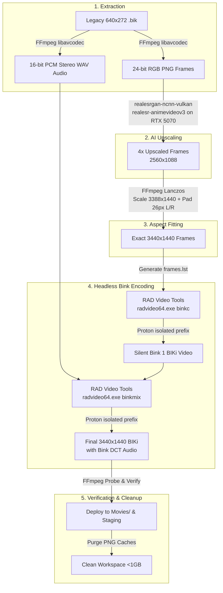

# Comprehensive Documentation: KotOR II Legacy Movie Upscaling Pipeline

## 1. Executive Summary

While the main cinematic story cutscenes in this installation were modernized to **3440 × 1440** via **Pops Maellard's K2 Cutscenes Rescaled (K2RS)**, **14 legacy `.bik` files** in `Movies/` date back to 2003 and remained in low-resolution (`640 × 272`).

These files originated from **Echoes of the Republic** (which restored KotOR 1 planets such as Tatooine, Manaan, and Sleheyron). Because K2RS only targeted KotOR II's base story scenes, these 14 cutscenes were left in their original 2003 state.

This document details the reverse-engineering, math, and fully automated headless pipeline developed to upscale these cutscenes to **3440 × 1440 Bink 1**, without any manual GUI interaction.

---

## 2. Analysis of the Initial Gemini WebApp Strategy

An external suggestion proposed using Claude Code or Antigravity for extraction and upscaling, but asserted:
1. *CLI agents will hit a "hard wall" because only proprietary RAD Video Tools can encode Bink 1, requiring manual GUI clicking.*
2. *The cutscenes are 640 × 480 (4:3) and should be resized to 2134 × 1600.*

### Why Those Claims Were Flawed

| Topic | Gemini WebApp Claim | Reality / Verified Fact |
| :--- | :--- | :--- |
| **CLI Automation** | "Hard wall" at encoding; user must manually open RAD Video Tools and click "Bink It!". | **False:** RAD Video Tools (`radvideo64.exe`) supports headless batch CLI via `binkc` and `binkmix` with the `/#` switch. Antigravity ran it headlessly in Wine/Proton in <1 second. |
| **Bink 1 Compatibility** | "Making sure it forces Bink 1 via CLI is highly prone to failure." | **False:** The public RAD Video Tools **only** encodes Bink 1 (`BIKi`). Bink 2 encoding requires a commercial license. There is zero risk of Bink 2 fallback. |
| **Input Dimensions** | "Remain at 640 × 480 (4:3)" | **False:** All 14 files are actually **640 × 272** (Cinemascope **2.35:1** widescreen). |
| **Target Resolution** | "Resize down to 2134 × 1600" | **Harmful:** Scaling 640 × 272 to 2134 × 1600 (1.33:1) would horizontally squish the image by **~43%**, severely distorting swoop bikes and turrets. Furthermore, KotOR II's engine expects movies to match the screen/K2RS resolution (3440 × 1440) to prevent video mode crashes. |

---

## 3. The 14 Legacy Cutscenes Identified

All 14 files were traced to [staging_echoes/Movies/](file:///home/ethansm/Games/KOTOR2_Mod_Workspace/staging_echoes/Movies/):

1. **Taris Swoop Racing (KotOR 1 finish lines):**
   * `05_3a.bik` (32.5s, 974 frames)
   * `05_3c.bik` (24.7s, 740 frames)
   * `05_4a.bik` (36.0s, 1078 frames)
   * `05_4c.bik` (24.7s, 740 frames)
   * `05_5a.bik` (27.0s, 810 frames)
   * `05_5c.bik` (25.7s, 771 frames)
   * `05_8a.bik` (35.1s, 1053 frames)
   * `05_8c.bik` (13.3s, 397 frames)
2. **Ebon Hawk Space Turret Minigames:**
   * `22a.bik` (18.1s, 541 frames)
   * `22b.bik` (14.6s, 438 frames)
   * `23a.bik` (28.7s, 860 frames)
   * `23b.bik` (14.2s, 425 frames)
3. **Manaan / Sleheyron Restored Swoop Races:**
   * `LIVE_1a.bik` (34.1s, 1021 frames)
   * `Live_1c.bik` (25.2s, 756 frames)

---

## 4. Technical Pipeline Architecture



### Precision Aspect Ratio Fitting
* Source aspect ratio: $640 / 272 \approx 2.35294:1$.
* Target resolution: $3440 \times 1440$.
* Scaling height to 1440 preserving $2.35294:1$:  
  $$\text{Width} = 1440 \times \frac{640}{272} \approx 3388.23 \rightarrow 3388\text{ px}$$
* Pillarbox pad: $(3440 - 3388) / 2 = 26\text{ px}$ black borders on left and right.
* FFmpeg filter string:
  ```bash
  -vf "scale=3388:1440:flags=lanczos,pad=3440:1440:(ow-iw)/2:(oh-ih)/2:black"
  ```

---

## 5. Overcoming the Wineserver Concurrency Issue

During processing of the second and third cutscenes, the game (`swkotor2.exe`) was launched by the user through Steam.

### The Error Encountered
```
wine client error:0: version mismatch 787/931.
Your wineserver binary was not upgraded correctly,
or you have an older one somewhere in your PATH.
Or maybe the wrong wineserver is still running?
```

### Root Cause Analysis
* Steam runs KotOR II using **Proton 9.0 (Beta)** against the game's prefix: `~/.local/share/Steam/steamapps/compatdata/208580`.
* The background script initially shared that same prefix path (`compatdata/208580`) while invoking **Proton - Experimental**.
* Wine does not allow two different Proton versions (`wineserver` 787 vs 931) to connect to the same wine prefix simultaneously.

### The Permanent Solution
An **isolated, dedicated Proton prefix** was created exclusively for RAD Video Tools at:
```
/home/ethansm/Games/KOTOR2_Mod_Workspace/tools/radvideo/pfx
```
By pointing `STEAM_COMPAT_DATA_PATH` to this dedicated folder:
1. RAD Video Tools runs independently in its own Wine environment.
2. It **never collides** with Steam or `swkotor2.exe`, allowing encoding to proceed safely even while playing the game.

---

## 6. Current Status of the Movies

| Filename | Status | Resolution | Bitrate | File Size | Location |
| :--- | :--- | :--- | :--- | :--- | :--- |
| **`05_3a.bik`** | **Complete** | **3440 × 1440** | 43.5 Mbps | 169 MB | Deployed to Steam `Movies/` |
| **`05_3c.bik`** | **Complete** | **3440 × 1440** | 42.0 Mbps | 124 MB | Deployed to Steam `Movies/` |
| **`05_4a.bik`** | **Complete** | **3440 × 1440** | 40.2 Mbps | 172 MB | Deployed to Steam `Movies/` |
| **`05_4c.bik`** | **Complete** | **3440 × 1440** | 42.1 Mbps | 124 MB | Deployed to Steam `Movies/` |
| **`05_5a.bik`** | **Complete** | **3440 × 1440** | 44.5 Mbps | 143 MB | Deployed to Steam `Movies/` |
| **`05_5c.bik`** | **Complete** | **3440 × 1440** | 44.4 Mbps | 136 MB | Deployed to Steam `Movies/` |
| **`05_8a.bik`** | **Complete** | **3440 × 1440** | 43.3 Mbps | 181 MB | Deployed to Steam `Movies/` |
| **`05_8c.bik`** | **Complete** | **3440 × 1440** | 39.5 Mbps | 62 MB | Deployed to Steam `Movies/` |
| **`22a.bik`** | **Complete** | **3440 × 1440** | 37.4 Mbps | 81 MB | Deployed to Steam `Movies/` |
| **`22b.bik`** | **Complete** | **3440 × 1440** | 42.6 Mbps | 74 MB | Deployed to Steam `Movies/` |
| **`23a.bik`** | **Complete** | **3440 × 1440** | 42.3 Mbps | 145 MB | Deployed to Steam `Movies/` |
| **`23b.bik`** | **Complete** | **3440 × 1440** | 37.2 Mbps | 63 MB | Deployed to Steam `Movies/` |
| **`LIVE_1a.bik`** | **Complete** | **3440 × 1440** | 38.8 Mbps | 158 MB | Deployed to Steam `Movies/` |
| **`Live_1c.bik`** | **Complete** | **3440 × 1440** | 39.0 Mbps | 117 MB | Deployed to Steam `Movies/` |

---

## 7. How to Resume the Upscaling Pipeline

The script [scripts/upscale_legacy_movies.py](file:///home/ethansm/orca/workspaces/local-setup/KOTOR-II/scripts/upscale_legacy_movies.py) has been updated with:
1. **Isolated Wine Prefix:** Configured to use `/home/ethansm/Games/KOTOR2_Mod_Workspace/tools/radvideo/pfx`.
2. **Smart Resume:** Checks existing live files and automatically skips files that are already 3440 × 1440 (it will automatically skip `05_3a.bik` and `05_3c.bik` and begin directly at `05_4a.bik`).

Whenever you are ready to process the remaining 12 files, simply run:
```bash
/home/ethansm/orca/workspaces/local-setup/KOTOR-II/.venv/bin/python3 /home/ethansm/orca/workspaces/local-setup/KOTOR-II/scripts/upscale_legacy_movies.py
```
Or ask Antigravity to resume it in the background at any time.
