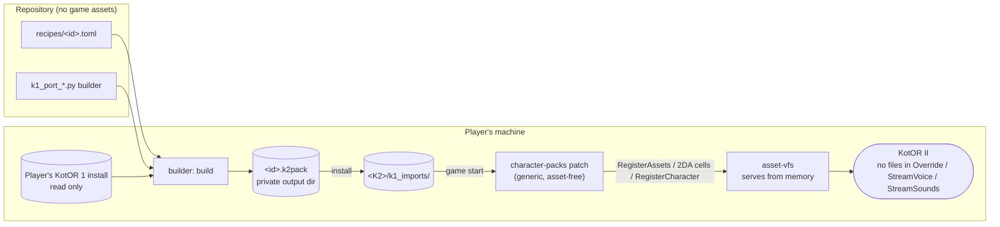

# Field notes: importing KotOR 1 characters into TSL (MDLOps vs PyKotor, install-time packs)

**Type:** Technical write-up, shared for reference. Not a feature request, and no response is needed.  
**Components touched:** `asset-vfs`, `character-packs` (a loader patch), a private Python builder (`k1_port`), and a probe build that spawns the imported characters.  
**Status:** Exploration, now parked. The MDLOps route produced clean, playable bodies. The patched-PyKotor route did not, and I stopped there. I have no plans to take it further; the notes below are what I learned.  
**Platform:** Steam/Aspyr only. `asset-vfs` and `character-packs` ship no GOG hooks.  
**Related:** The loader and `asset-vfs` are an example of the provider/consumer pattern discussed in [#180](https://github.com/LaneDibello/Kotor-Patch-Manager/issues/180) (one patch serves resources, others register into it).

---

### Summary

1. **Play-tested and working (MDLOps route):** Juhani and Carth, with body, head, textures, idle animation, their own K1 barks, voiced dialog and lip-sync, in Telos `204tel`. Mission was built the same way and passes the structural validator, but I had not played that build when I parked this.
2. **Not working:** the same bodies written by a patched PyKotor 2.3.12 writer. I found and fixed several real defects, including the cause of the "held-out arm", but bodies still rendered with exploded geometry. I did not find the remaining cause.
3. **The distribution idea held up:** the repository commits no game assets. A builder runs on the player's machine, reads their own K1 install, and writes a private `.k2pack` per character. One generic, asset-free loader patch registers it with `asset-vfs` at start-up.
4. **Useful facts for anyone doing a K1 to K2 port:** node numbering, voice file placement, `.lip` validation, dialog string tables, and shared pool limits (details below).
5. **PyKotor fork check:** the active `vrifftech/PyKotor` fork rewrote the MDL I/O. I tried it; it keeps K1 node numbers on a K1 to K2 write.

---

### Motivation & Background

KotOR 1 has companions, heads and voiced dialogue that never appeared in KotOR 2. Community attempts to bring them into TSL usually hit the same problems:

1. **Skeleton deformations:** twisted limbs, geometry shards, or the "held-out arm" (one arm permanently pointing straight out).
2. **Toolchain differences:** stock PyKotor 2.3.12 cannot write K2 binary MDLs. It fails on the trimesh header size, and its skin layout differs from the engine's.
3. **Audio and lip-sync placement:** wrong file placement gives silent dialog, and a malformed `.lip` crashes the game on first speech (`c0000005` in `swkotor2.exe` at `0x0091CF5B`).
4. **Redistribution:** every converted model, texture and voice line is a KotOR 1 asset, so a mod that ships them cannot go in a public repo or a release.

Point 4 shaped the design. The repository holds recipes (instructions per character), a builder and a loader patch, and nothing from the game.

---

<!-- Optional: drag a screenshot of Juhani or Carth in 204tel (MDLOps build) here before posting. -->

### What Didn't Work: Dead Ends & Root Causes

#### 1. A patched PyKotor 2.3.12 writer for K2 bodies

I patched PyKotor 2.3.12 (from PyPI) to write K2 MDLs, then diffed its output against MDLOps output for the same K1 model. Defects found and fixed:

* **Trimesh header overshoot:** stock PyKotor raised `ValueError: _TrimeshHeader.write wrote 348 bytes, expected 340`. The K2 branch wrote the dirt/tail fields wrongly, so all downstream offsets were off.
* **Inverted skin MDX layout:** vanilla K1/K2 put weights at row offset `+0x20` and bone indices at `+0x30`. Stock PyKotor had them swapped.
* **Skin pointers:** `bonemap`/`qbones`/`tbones` pointers were computed before the data order was fixed and trailed their arrays by up to 1,532 bytes.
* **Tangent blocks and `bones16` padding:** raw tangent blocks were dropped, and junk in the `bones[16]` padding and stale face planes broke meshes.
* **Node header supernode (`+2`) and geometry total:** the writer stored each node's own file index and its own node count. The K2 engine expects supermodel-chain numbering: a node that also exists in the supermodel inherits that node's number, an unmatched child gets the next free number above the supermodel's range, and the total is own count plus the supermodel's. I wrote a stdlib post-pass for this and checked its rules exact on 398 of 398 vanilla K2 models that have a supermodel. With it, the held arms were fixed in play.
* **Skin `unknown0` array:** the patch kept the K1 values, which are leftover memory (heap pointers, float bit patterns). MDLOps writes zeros. I zeroed it after writing.

**After all of that, bodies were still wrong in play** (exploded geometry on Juhani, Carth and Mission). The same characters built through MDLOps were clean. A field-by-field comparison of the two outputs found equal node headers, controllers, `qbones`/`tbones`, and per-vertex bone bindings. What still differs: one vertex per face corner (for example 144 versus 43 vertices on a pelvis mesh), flat versus smoothed normals, a zero mesh-area field, and a different (but self-consistent) bone-slot order. I did not test whether any of those matter, and I do not know the remaining cause. The pipeline therefore uses MDLOps for bodies, and I am leaving the PyKotor path as an unused experiment.

* **Danglymesh:** a K1 head with a danglymesh hair node written by the patched writer was not read the same way by the engine as one written by MDLOps. I demote it to a plain trimesh, so hair is static. A second patch writes the vanilla layout; I did not get as far as playing it.

#### 2. The "held-out left arm"

* **False lead (node name casing):** lowercasing node names did not matter. A variant keeping exact K1 casing still held the arm out.
* **Real cause (node numbering):** the engine does not match bones by name at runtime. It uses the numeric node number relative to the supermodel chain. MDLOps numbers nodes from the supermodel binaries in its working directory. Given K1 supermodels it produced K1 numbers (`pelvis_g` 68, `lhand_g` 28); K2 expects its own (`pelvis_g` 86, `lhand_g` 62). Staging the K2 chain (`S_Female03`, `S_Female02`, `S_Male01` and so on) in the MDLOps working directory fixed it. The same numbering rule was the cause behind the PyKotor arm defect above.
* **User-modded supermodels:** if the player has a modified `S_Female02` or `S_Female03` in `Override`, the game loads that file, so numbering must follow it. The builder prefers `Override`, warns, and records it in the manifest.

#### 3. Voice streaming and lip-sync placement

* **The Override trap:** `.wav` voice files placed directly in `Override/` open but play silence.
* **Subfolders:** older notes suggest `StreamVoice/<dlg_resref>/`. Reading the resource loader (`FUN_0091CF18`), voice files without special prefixes (`gbl`, `avo`, `000`) must sit **flat inside `StreamVoice/`**. `.lip` files are ordinary resources.
* **A corrupt `.lip` kills the game.** A bad header or key count crashed `swkotor2.exe` at `0x0091CF5B` on first speech. The importer validates every lip before it enters a pack and drops any that fail.

#### 4. Dialog and strings do not transfer by reference

* Carth's K1 conversation (`k_hcar_dialog`) has 978 nodes and 722 string references. **0 of 722 match the K2 `dialog.tlk`.** Dialog text has to be copied into the converted `.dlg` itself.
* **Barks are the opposite.** The K1 bark rows for Carth (37192..37232) and Juhani (36914..36942) are the same strings in the K2 TLK, so a soundset only needs the K1 `.ssf` and its sound files.
* K1 conversations call K1 scripts (42 for Carth) that cannot run in K2. My rule was to strip every script and keep only nodes reachable without a condition script. That leaves 6 of 978 nodes for Carth and 6 of 1272 for Juhani: a spoken greeting and a reply. The slice for Carth and Mission read as generic and worked wherever they were placed.
* **Creature `TextureVar` is ignored by the engine** (appearance is armor-item driven), so a per-creature texture variant is not a way to get alternate skins.

---

<!-- Optional: drag a screenshot of an imported companion's voiced conversation here before posting. -->

---

### What Worked: Install-Time Packs

* **Recipes** (committed) say which K1 models, textures, soundset and conversation make up a character. No row numbers, no bytes.
* **Builder:** resolves every source through the player's K1 install (Override first, then BIF and texture packs), converts, bakes TPCs, assigns table rows from the live K2 table height (kept stable in an assignments file), and writes one `.k2pack` per character plus a manifest listing each source, hash and licence class. It never writes to the K1 folder and reads the K2 folder read-only until an explicit `install` copy.
* **Pack** (`.k2pack`): one character block, an asset table, a 2DA cell table and blobs, CRC-checked, little-endian, no code. At most 448 assets per pack.
* **Loader** (`character-packs`): a generic, asset-free patch. At start-up it reads `<game>/k1_imports/*.k2pack` synchronously with plain kernel32 file calls (no library loads under the loader lock; a worker thread would race `asset-vfs`, which drops 2DA cells registered after the table was serviced). It re-validates magic, version, CRC, offsets and counts, then registers assets, 2DA cells and the character with `asset-vfs`. A damaged pack is skipped with a log line.
* **Building from MDLOps:** pass 1 exports ASCII, pass 2 compiles `-k2` against the staged K2 supermodel chain, then the output is validated structurally (0 findings expected). Building Carth from a K1 install this way gave an MDL/MDX set **byte-identical** to the one I had built by hand earlier, and TPCs identical to the hand bundle. The only difference was the danglymesh demotion on the head.

| Layer | Source in K1 | In the pack |
|---|---|---|
| Body A/B + head models | `p_<name>ba/bb/h` MDL/MDX | converted to K2 binary with MDLOps against the K2 supermodel chain |
| Textures | TexturePack/BIF TGA/TPC | DXT1/DXT5 TPC baked on the player's machine (opaque flag, `clamp 1` TXI for heads, rows bottom-up) |
| Creature | UTC, `appearance.2da` / `heads.2da` rows | new rows from the live table height |
| Barks | K1 `.ssf` and its sounds | new `soundset.2da` row, K1 `.ssf`, all its wavs |
| Dialog | K1 `.dlg` | rewritten `.dlg` with embedded text, scripts stripped, unconditional nodes only |
| Voice-over | K1 `streamwaves/...` | flat `StreamVoice` assets, up to 30 lines by default |
| Lips | K1 `lips/*.mod` | validated, then packed |

**Licence guardrails:** every source gets an origin and a licence class. Files from the player's `Override` cannot be classified, so they count as flagged. The builder refuses to run unless the output folder is private (outside every git work tree, outside the Steam trees and both game folders, not reached through a symlink). Nothing derived from K1 is committed or released.

**Spawning:** a probe build spawns a small test roster in `204tel` through the `npc-world` provider, at positions I checked against the area walkmesh. That is a test, not a feature.

---

### Capacity limits found by doing it

* `asset-vfs` shares its static asset pool and 2DA cell pool between all mods. The pools were 192 assets and 256 cells; I raised them to 448 assets (plus 64 reserved for dynamic registrations) and 1024 cells after packs ran out (a third character got 47 of its 102 cells and lost its heads row).
* A character costs about 100 cells and 40 to 50 assets. A pack with 30 voiced dialog lines is the practical per-character ceiling, and the pool holds roughly nine characters. Full conversations of hundreds of voiced lines would need a much larger pool.
* **Two providers must not register the same resref.** An older hand-made bundle for Juhani and the pack used the same resrefs. The bundle's test dialog was served instead of the pack's, because a later registration only replaces an earlier one until the resource has been served once. I uninstalled the bundle. A duplicate-resref warning in the loader would have saved me a debugging session.

---

### Comparison with the active PyKotor fork

I built against PyPI `pykotor==2.3.12`. That release matches OpenKotOR `master`: the pristine `io_mdl.py` differs only in the reader's BIF offset handling, and the writer and `mdl_data.py` are the same. The fork [`vrifftech/PyKotor`](https://github.com/vrifftech/PyKotor) is 50 commits ahead of OpenKotOR `master` (last push 2026-10-17, checked 2026-10-20) and has rewritten `mdl/io_mdl.py`. My patches are diffs against the old file, so they do not apply to the rewrite.

* **What the fork already has:** the K2 340-byte trimesh header with dirt fields, K2 pointer tables, and skin array pointers built from the data. It keeps source node header bytes on a round trip and writes the skin `unknown` array from the model's own data.
* **Test (2026-10-20):** I installed the fork into a separate venv and converted K1 `p_juhaniba` and `p_juhanibb` with `force_game = K2`. Both write without errors. The node numbers stay K1's (`pelvis_g` is 68; K2's is 86), so a K1 to K2 write still needs the supermodel-chain renumbering step.
* **Not checked:** the fork's skin arrays on that output, and nothing was played.
* If it is useful to the fork's maintainers: the numbering rules (R0 to R5, stdlib, checked on 398 vanilla K2 models) are easy to lift into any writer. I am not planning a pull request.
